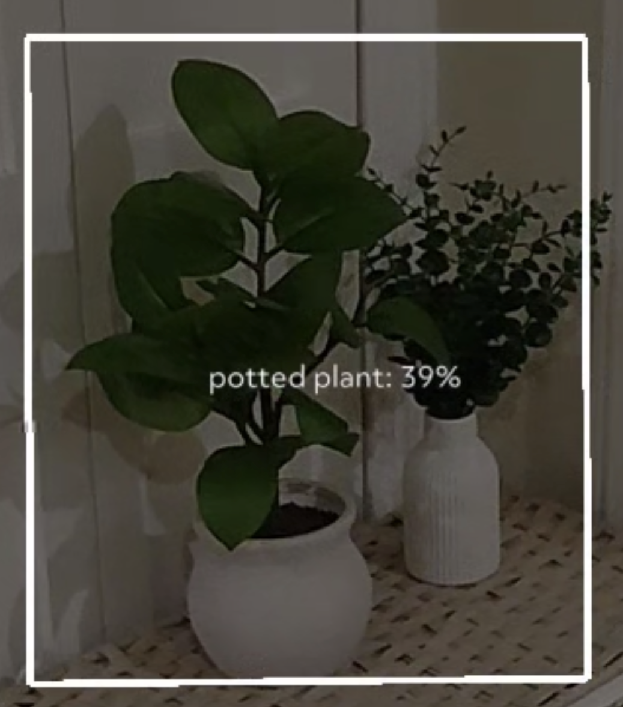
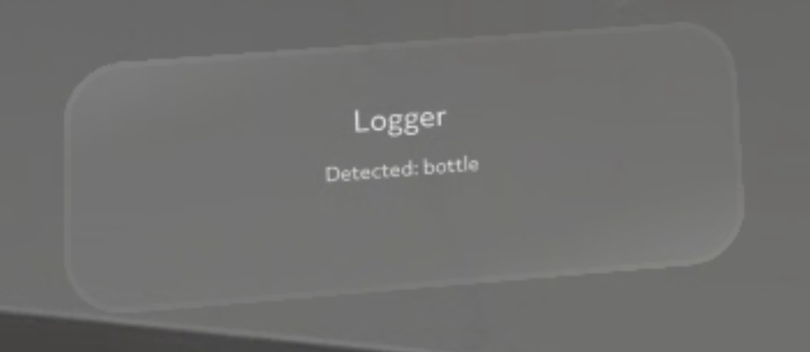
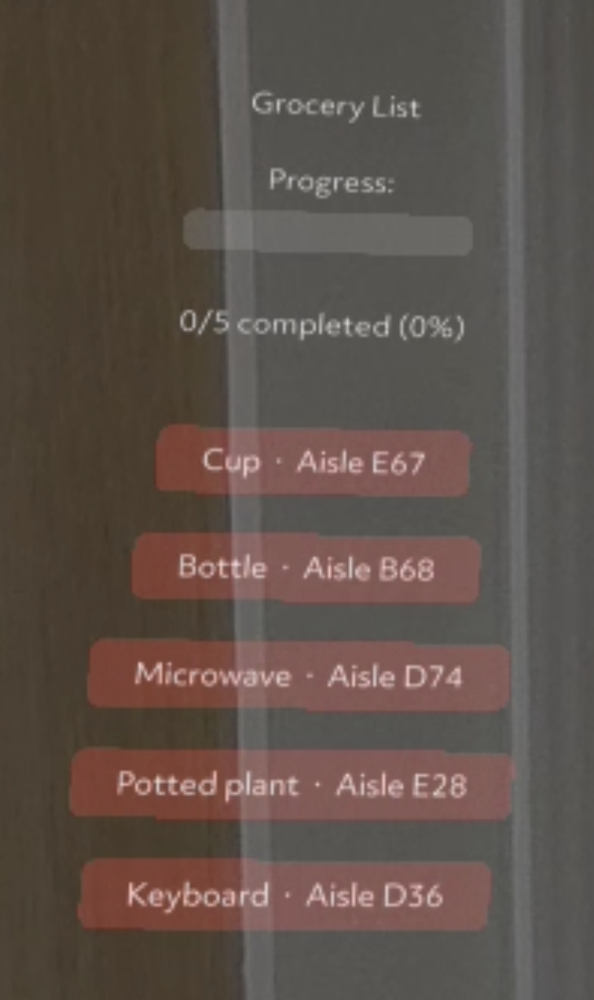
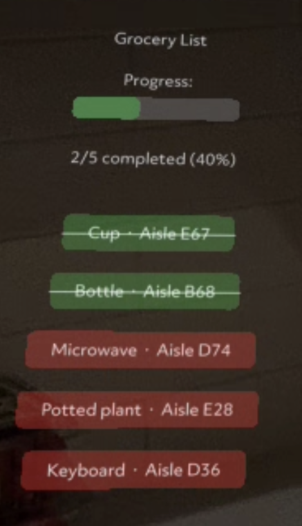
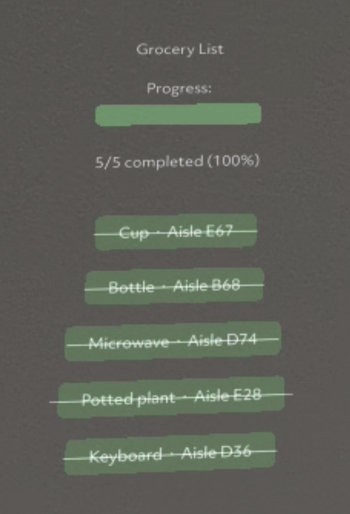
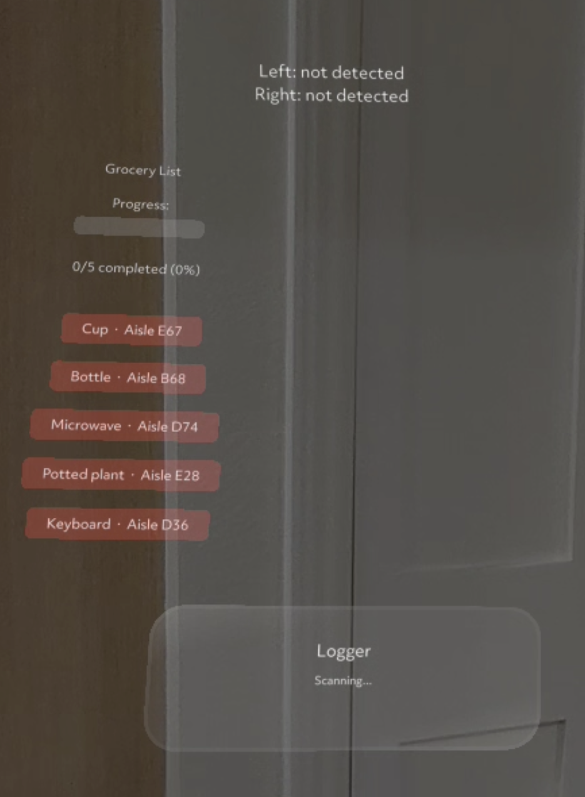
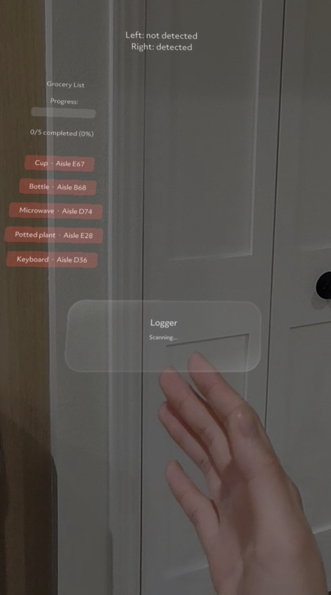
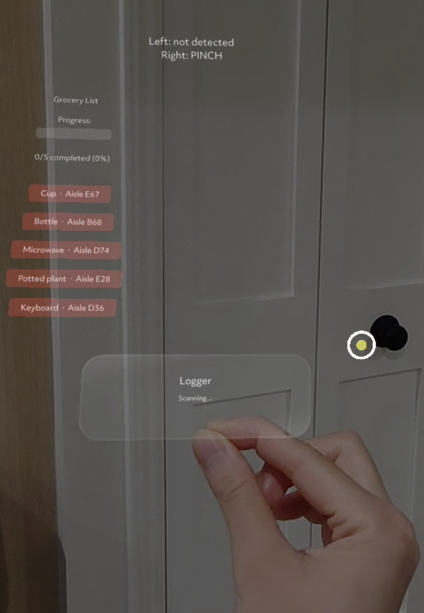
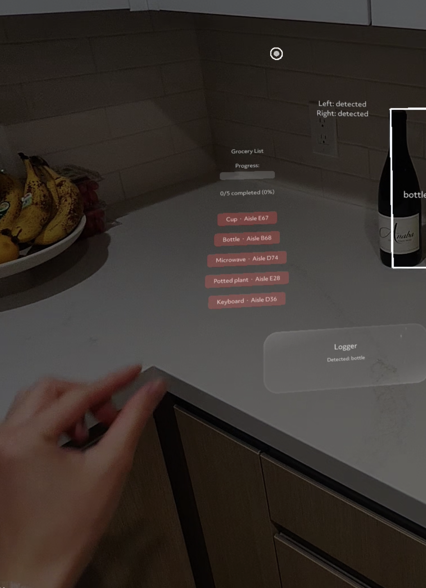
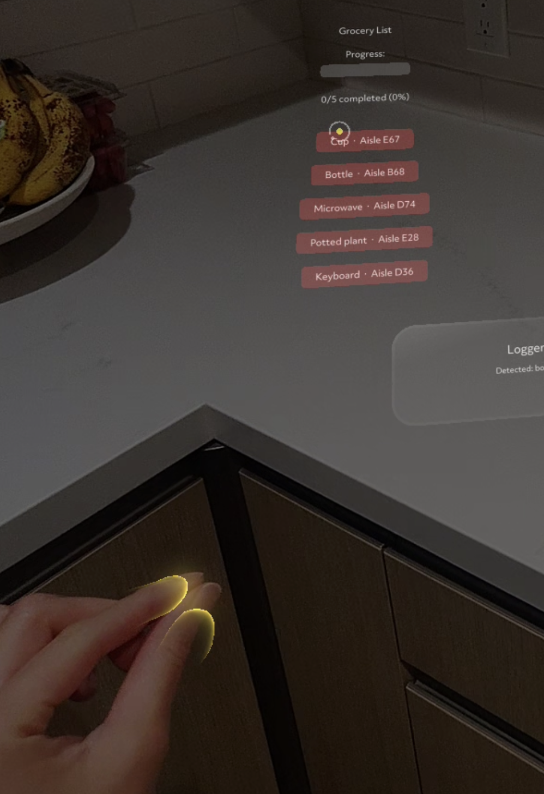

# AisleVision

## Team

| Name | GitHub | Email |
|------|--------|-------|
| Jumana Ayoub | [@jumanaayoub1](https://github.com/jumanaayoub1) | jumana.ayoub@sjsu.edu |
| Joshua Pastores | [@jjpastores](https://github.com/jjpastores) | joshua.pastores@sjsu.edu |
| Toey Lui | [@toeyldev](https://github.com/toeyldev) | toey.lui@sjsu.edu |
| Bush Nguyen | [@bush-nguyen](https://github.com/bush-nguyen) | bush.nguyen@sjsu.edu |

**Advisor:** Mark Rayes

---

## Project Description

AisleVision is an Augmented Reality (AR) grocery assistant designed for Snap Spectacles. It uses computer vision to detect and track grocery items in real time while displaying an in-view checklist that helps shoppers locate items efficiently. The long-term vision is to integrate real-time object detection, smart checklist management, and indoor path planning into a hands-free shopping experience that makes navigating stores more efficient and accessible.

---

## Prototype Scope

#### Works end to end:
- **Real-time Object detection:**
    -  YOLOv7-tiny runs on Spectacles through SnapML.
    -  Detected objects are labeled with confidence score and bounding box in the AR view.
- **Backend:**
    - Connects to Lens Studio.
    - A FastAPI server exposes the checklist as a REST API (`GET`/`POST` items, `PATCH` to check an item, `DELETE`).
    - The Spectacles lens reads the checklist from the server over HTTPS (ngrok tunnel) and refreshes it every 5 seconds.
- **Database:**
  - Checklist items are stored in MySQL (`aislevision` database) so the list persists between sessions.
- **Checklist:**
  - The checklist is shown in the AR view as one row per item with a progress bar and percentage.
  - User can pinch to check items off the checklist.
  - The aisle number of the checklist is displayed.
- **Path Planning:**
  - 2D store-map data collection and an A* pathfinding algorithm with unit tests (branch: `feature/2d-path-planning`).

#### Incomplete/left for the Expo:
- **Object detection and checklist:**
  - Connect detection to the checklist: When the user picks up an item and their hand touches the item's bounding box, the item checks itself off the list automatically.
- **Path planning:**
  - Integrate 2D path planning into the checklist so items are reordered based on location in the store.
- **Optional:**
  - Voice narration and 3D arrows for navigation.
  - Add more grocery items to detection by custom-training the model/adding second detection model.

---

## Prerequisites

#### Hardware and Account
- Snap Spectacles 24 device (SnapOS v.5.64+)
- A Snap account for Lens Studio and the Spectacles app

#### AR Glasses
- **Desktop**: [Snap AR Lens Studio For Spectacles](https://ar.snap.com/spectacles?utm_campaign=LensStudio_PM_P0_RET&utm_content=LS_ProductPage&utm_medium=PAIDPLATFORM&utm_source=GooglePM&utm_term=Retargeting_LS_Downloaders) (v.5.15.4+)
- **Mobile**: Spectacles app
  - [iOS](https://apps.apple.com/us/app/spectacles-by-snap-inc/id6502670261)
  - [Android](https://play.google.com/store/apps/details?id=com.snap.spectacles.app&hl=en_US&pli=1)
  - Ensure Spectacles firmware is up to date via the mobile app (Check Settings → Software Update)

#### Backend and Web
- Python 3.10+
- MySQL Community Server (8.x+)
- Node.js LTS (with `npm`)
- ngrok
- Git
- macOS/Windows development machine

---

## Installation
#### Clone and Install Tools
1. Install the tools listed under Prerequisites: Lens Studio, Python 3.10+, MySQL, Node.js, ngrok.
2. Clone the repository:
   ```bash
   git clone https://github.com/SJSU-CMPE-195/group-project-team-ar.git
   ```
   Navigate to the project folder:
   ```bash  
   cd group-project-team-ar
   ```
#### Database and Backend
3. Start MySQL and set a password for your MySQL user.
4. Create a database from the repo root:
   ```bash  
   mysql -u root -p < server/sql/init.sql
   ```
5. Create Python virtual environment and install packages:
   ```bash
   python3 -m venv server/.venv
   ```
   Install packages:
   ```bash
   server/.venv/bin/python -m pip install -r server/requirements.txt
   ```
6. Create server settings file and fill in values:
   ```bash
   cp server/.env.example server/.env
   ```
#### Web App
7. Install web app packages:
   ```bash
   cd web
   npm install
   ```
8. Optional: to point the web app at a different API address, copy `web/.env.example` to `web/.env` and set `VITE_API_URL`.

#### Spectacles and Lens Studio
9. Install and open Lens Studio.
10. Pair Spectacles with the Spectacles mobile app.
11. Connect Spectacles to Lens Studio.
    - **Wireless**: Ensure Spectacles and your computer are on the same WiFi network.
    - **Wired**: Connect Spectacles to your computer using a USB-C cable.
12. Open `src/lensstudio-snapMLstarter/lensstudio-snapMLstarter.esproj`.
13. For testing on Spectacles, install ngrok and add your authtoken once: `ngrok config add-authtoken <your-token>`.

---

## Running the Prototype
1. Start MySQL server.
2. Start API server:
   ```bash
   server/.venv/bin/python -m uvicorn server.main:app --host 0.0.0.0 --port 8000
   ```
   Check: (should return `{"ok":true,"database":"connected"}`)
   ```bash
   curl localhost:8000/health
   ```
3. Start web app:
   ```bash
   cd web
   npm run dev
   ```
   Open `http://localhost:5173` and add a few grocery items.
4. Start the tunnel (to run on Spectacles glasses, optional for Lens Studio preview):
   ```bash
   ngrok http 8000
   ```
5. Launch Lens Studio.
6. Open the Lens.
   - Click File → Open project file `src/lensstudio-snapMLstarter/lensstudio-snapMLstarter.esproj`.
   - Select GroceryListText and set Api Url on GroceryListController to:
       - Preview: `http://127.0.0.1:8000/api/lists/demo/items` (enable Allow Experimental API in Project Settings).
       - Spectacles: `https://<your-ngrok-address>/api/lists/demo/items`
7. Power on and connect Spectacles to mobile app and Lens Studio.
8. In Lens Studio, Click `Preview Lens`.
9. Wait for the lens to load on the Spectacles.
10. Look through the glasses at the grocery list, point at a row, and pinch to check an item off. The website updates and changes made on the website appear on the glasses within ~5 seconds.

---

## Testing

The API integration tests run without Spectacles hardware. Make sure MySQL is
running and `server\.env` contains your local database credentials. The API
creates its tables when it starts.

In the first PowerShell window, from the repository root, start the FastAPI
backend:

```powershell
.\server\.venv\Scripts\Activate.ps1
python -m uvicorn server.main:app --reload --host 0.0.0.0 --port 8000
```

In a second PowerShell window at the repository root, run:

```powershell
powershell.exe -NoProfile -ExecutionPolicy Bypass -File .\tests\test-api.ps1
```

The script automatically checks the FastAPI backend on port 8000, or the
Express backend on port 3000 if that is the server running. It verifies health,
item listing, create, check/uncheck, and delete using a uniquely named temporary
item, then removes it. Existing grocery items are not cleared. To test a server
at a different URL, set `API_BASE_URL` before running the script:

```powershell
$env:API_BASE_URL = "http://localhost:8000"
powershell.exe -NoProfile -ExecutionPolicy Bypass -File .\tests\test-api.ps1
```

---
## Demo

#### Video:
[AisleVision Prototype Demo Video](https://drive.google.com/file/d/1zuYUwf4mVuQKaxN_3KR-a3IoUTkmXzV9/view?usp=sharing)


#### Screenshots:

1. Object Detection:
<table>
  <tr>
    <td align="center">
      Figure 1. Detected object with bounding box
    </td>
    <td align="center">
      Figure 2. Object detection logger
    </td>
  </tr>
  <tr>
    <td align="center">
      
    </td>
    <td align="center">
      
    </td>
  </tr>
</table>

2. Checklist:
<table>
  <tr>
    <td align="center">
      Figure 3. Initial
    </td>
    <td align="center">
      Figure 4. In Progress
    </td>
    <td align="center">
      Figure 5. Completed
    </td>
  </tr>
  <tr>
    <td align="center">
      
    </td>
    <td align="center">
      
    </td>
    <td align="center">
      
    </td>
  </tr>
</table>

3. Hand Gesture Detection and Control:

- Text indicator:

<table>
  <tr>
    <td align="center">
      Figure 6. Hands Not Detected
    </td>
    <td align="center">
      Figure 7. Right Hand Detected
    </td>
    <td align="center">
      Figure 8. Right Hand Pinch Detected
    </td>
  </tr>
  <tr>
    <td align="center">
      
    </td>
    <td align="center">
      
    </td>
    <td align="center">
      
    </td>
  </tr>
</table>

- Cursor:
<table>
  <tr>
    <td align="center">
      Figure 9. Default cursor
    </td>
    <td align="center">
      Figure 10. Pinch cursor
    </td>
  </tr>
  <tr>
    <td align="center">
      
    </td>
    <td align="center">
      
    </td>
  </tr>
</table>


---

## Technical Stack

| Category | Technology |
|----------|------------|
| Spectacles Lens | Lens Studio, JavaScript, TypeScript |
| Backend | Python, FastAPI, SQLAlchemy |
| Web App | Vite, JavaScript |
| Database | MySQL |
| Networking | REST API, ngrok (HTTPS tunnel for Spectacles) |
| Object Detection | SnapML framework, YOLOv7-tiny (ONNX) |
| Hand Tracking | Spectacles Interaction Kit (pinch, cursor) |
| Path Planning | TypeScript, A* algorithm on 2D map |
| Hardware | Snap Spectacles |
| Deployment | Snap Spectacles / Lens Studio |

---

## What's Next (Before Project Expo)
**Object detection and checklist:**
- Connect detection to the checklist: When the user picks up an item and their hand touches the item's bounding box, the item checks itself off the list automatically.
- _(Bonus): Add more grocery items to detection by custom-training the model/adding second detection model._

**Path planning:**
- Integrate 2D path planning into the checklist backend so items are reordered based on location in the store.
- _(Bonus): Add voice narration or 3D arrow visuals for navigation._

**Testing:**
- Test overall system in real Target stores.
- Conduct user testing and collect user experience feedback.

*CMPE 195A/B - Senior Design Project | San Jose State University | Spring-Fall 2026*
