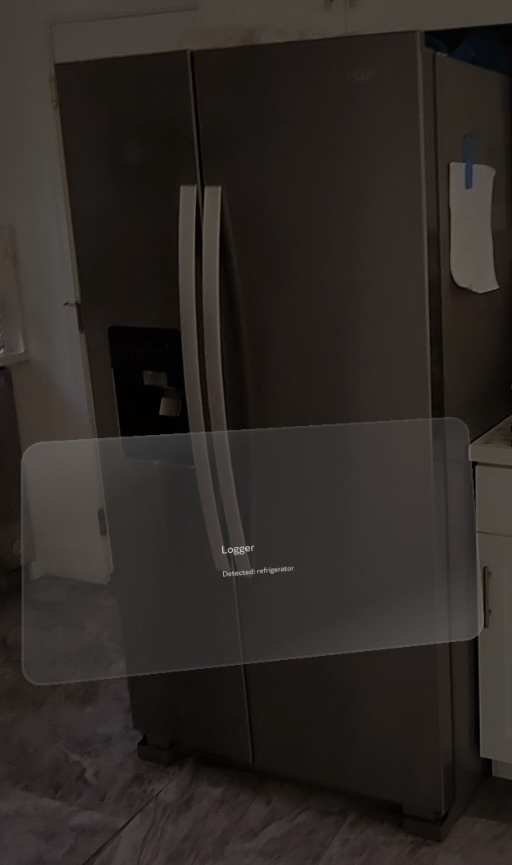
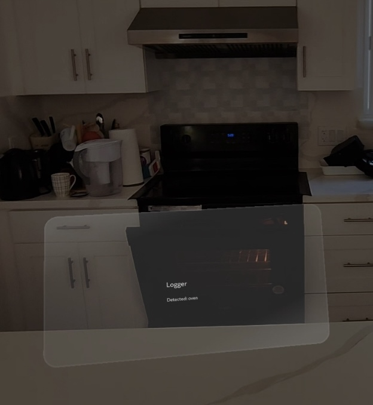
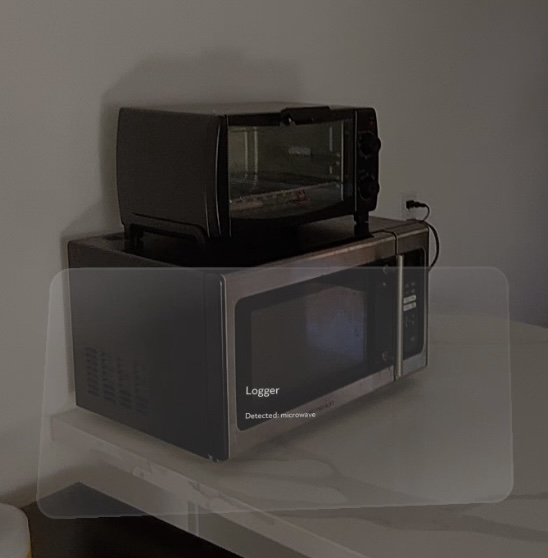

# AisleVision

## Team

| Name | GitHub | Email |
|------|--------|-------|
| Jumana Ayoub | [@jumanaayoub1](https://github.com/jumanaayoub1) | jumana.ayoub@sjsu.edu |
| Joshua Pastores | [@jjpastores](https://github.com/jjpastores) | joshua.pastores@sjsu.edu |
| Toey Lui | [@toeyldev](https://github.com/toeyldev) | toey.lui@sjsu.edu |
| Bush Nguyen | [@bush-nguyen](https://github.com/bush-nguyen) | bush.nguyen@sjsu.edu |

**Advisor:** Jun Liu

---

## Project Description

AisleVision is an Augmented Reality (AR) grocery assistant designed for Snap Spectacles. It uses computer vision to detect and track grocery items in real time while displaying an in-view checklist that helps shoppers locate items efficiently. The long-term vision is to integrate real-time object detection, smart checklist management, and indoor path planning into a hands-free shopping experience that makes navigating stores more efficient and accessible.

---

## Proof of Concept Scope
This PoC demonstrates real-time object detection running on Spectacles using a YOLOv7-tiny model deployed through SnapML, along with a checklist user interface displayed directly in the AR view. At this stage, detected objects are presented as item labels in a list.

The current PoC does not include backend or database integration, functional checklist syncing, indoor path planning, focus mode, and fully implemented 2D/3D bounding boxes around detected items in the AR environment.

---

## Prerequisites

- Snap Spectacles 24 device (SnapOS v.5.64+)
- **Desktop**: [Snap AR Lens Studio For Spectacles](https://ar.snap.com/spectacles?utm_campaign=LensStudio_PM_P0_RET&utm_content=LS_ProductPage&utm_medium=PAIDPLATFORM&utm_source=GooglePM&utm_term=Retargeting_LS_Downloaders) (v.5.15.4+)
- **Mobile**: Spectacles app
  - [iOS](https://apps.apple.com/us/app/spectacles-by-snap-inc/id6502670261)
  - [Android](https://play.google.com/store/apps/details?id=com.snap.spectacles.app&hl=en_US&pli=1)
  - Ensure Spectacles firmware is up to date via the mobile app (Check Settings → Software Update)
- Git
- macOS or Windows development machine

---

## Installation
1. Clone the repository:
   ```bash
   git clone https://github.com/SJSU-CMPE-195/group-project-team-ar.git
   ```
2. Navigate to the project folder:
   ```bash  
   cd group-project-team-ar
   ```
3. Install and open Lens Studio.
4. Pair Spectacles with the mobile app.
5. Connect Spectacles to Lens Studio.
    - **Wireless**: Ensure Spectacles and your computer are on the same WiFi network
    - **Wired**: Connect Spectacles to your computer using a USB-C cable
6. Open the `.esproj` file inside the `src/` folder.

---

## Running the PoC
1. Launch Lens Studio.
2. Click File → Open project file `src/lensstudio-snapMLstarter/lensstudio-snapMLstarter.esproj`
3. Power on and connect Spectacles to mobile app and Lens Studio.
4. In Lens Studio, Click `Preview Lens`.
5. Wait for the lens to load on the Spectacles.
6. Look through the glasses to test object detection and checklist UI.

---

## Demo

**Video:**

- [Object Detection Video Demo](https://drive.google.com/file/d/110_xQSGt6r8sHk9DzaZ3XtIHVvOLsZT6/view?usp=sharing)


**Screenshots**

- Object Detection:
  
  
  
  

- Checklist:

---

## Technical Stack

| Category | Technology |
|----------|------------|
| Frontend | Vanilla JavaScript, Vite, Lens Studio |
| Backend | Python, FastAPI, SQLAlchemy |
| Hardware | Snap Spectacles |
| Database | MySQL |
| Deployment | Snap Spectacles / Lens Studio |
| Framework | SnapML |
| ML Model | YOLOv7-tiny |

---

## Grocery Checklist MVP

The checklist uses the same FastAPI service and MySQL database for the web app and the Spectacles Lens:

```text
Vanilla JavaScript web app ─┐
                            ├─ FastAPI REST API ─ MySQL
Lens Studio / Spectacles ───┘
```

Neither client connects to MySQL directly. The MVP includes one automatically-created `demo` list and supports adding, displaying, checking/unchecking, and deleting items.

### 1. Check and start MySQL on Windows

Run these commands in PowerShell:

```powershell
Get-Service | Where-Object {$_.Name -like "MySQL*"}
Test-NetConnection 127.0.0.1 -Port 3306
```

Start the installed service if it is stopped, using its exact service name. For this development machine, the running service is `MySQL97`:

```powershell
Start-Service -Name MySQL97
Get-Service -Name MySQL97
Test-NetConnection 127.0.0.1 -Port 3306
```

If Windows reports that administrator permission is required, reopen PowerShell as Administrator and run the same `Start-Service -Name <service-name>` command. Do not uninstall MySQL, reset passwords, or alter existing databases.

### 2. Create the `aislevision` database

The backend creates its tables automatically, but the database itself must exist first. In MySQL Workbench, connect to the running local MySQL Server and open and execute [`server/sql/init.sql`](./server/sql/init.sql). Alternatively, if the MySQL client is on `PATH`, run from the repository root:

```powershell
Get-Content .\server\sql\init.sql | mysql --host=127.0.0.1 --port=3306 --user=root --password
```

Enter the password already configured for the MySQL account when prompted; do not put it in the command. This SQL only creates the database if missing and selects it. It does not create tables or replace existing data.

### 3. Configure and start the FastAPI backend

From the repository root, create and activate a virtual environment, then install dependencies:

```powershell
py -3 -m venv server\.venv
.\server\.venv\Scripts\Activate.ps1
python -m pip install -r server\requirements.txt
```

The application reads `server\.env` if it exists. This repository may already contain a private local `server\.env`; preserve it and never overwrite it. For a new setup only, copy the example and set `MYSQL_PASSWORD` to your existing MySQL password (or leave it blank if that account is configured without one):

```powershell
if (-not (Test-Path server\.env)) {
  Copy-Item .env.example server\.env
  notepad server\.env
}
```

Start the API on port 8000:

```powershell
python -m uvicorn server.main:app --reload --host 0.0.0.0 --port 8000
```

The first startup creates the `shopping_lists` and `shopping_items` tables with SQLAlchemy and inserts list id `demo` if it does not exist.

### 4. Install and start the Vite web app

In a second PowerShell window, from the repository root:

```powershell
Set-Location web
npm install
if (-not (Test-Path .env)) { Copy-Item .env.example .env }
npm run dev
```

Open the Vite URL shown in the terminal (normally `http://localhost:5173`). The backend URL is configured once in `web\.env` as `VITE_API_URL=http://localhost:8000`; `web\src\api.js` uses that value and defaults to localhost:8000.

### 5. Start ngrok for Spectacles

In another PowerShell window, run:

```powershell
ngrok http 8000
```

Copy the HTTPS forwarding URL from ngrok (for example, `https://example.ngrok-free.app`) and set the Lens `apiUrl` Inspector input to:

```text
https://YOUR-NGROK-URL.ngrok-free.app/api/lists/demo/items
```

The API allows the local Vite origin and temporary HTTPS `*.ngrok-free.app` origins. Keep ngrok running while testing the Lens.

### 6. Test every API endpoint

With MySQL and the backend running, open another PowerShell window and run:

```powershell
$baseUrl = "http://localhost:8000"
Invoke-RestMethod "$baseUrl/health"
Invoke-RestMethod "$baseUrl/api/lists/demo/items"

$item = Invoke-RestMethod "$baseUrl/api/lists/demo/items" `
  -Method Post -ContentType "application/json" `
  -Body (@{ name = "API Test" } | ConvertTo-Json)
$item

Invoke-RestMethod "$baseUrl/api/items/$($item.id)" `
  -Method Patch -ContentType "application/json" `
  -Body (@{ checked = $true } | ConvertTo-Json)
Invoke-RestMethod "$baseUrl/api/lists/demo/items"

Invoke-WebRequest "$baseUrl/api/items/$($item.id)" -Method Delete -UseBasicParsing
Invoke-RestMethod "$baseUrl/api/lists/demo/items"
```

The list response includes `list_id`, `items`, `total`, and `completed`. Each item has `id`, `name`, and `checked`.

### 7. Connect and test the Lens checklist

Open `src\lensstudio-snapMLstarter\lensstudio-snapMLstarter.esproj` in Lens Studio and target Spectacles. If the script is not in the Asset Browser, drag `src\lensstudio-snapMLstarter\Assets\GroceryListController.js` into the Asset Browser. If `GroceryListText` is not in this project’s Scene Hierarchy, create a **Screen Text** object, name it `GroceryListText`, add a **Script Component**, and assign the `GroceryListController.js` asset. On its Grocery List Controller script component, assign these Inspector inputs:

1. **Grocery Text**: optionally drag the Text component on `GroceryListText` into this input; the script also auto-resolves the Text component on the same object.
2. **Internet Module**: the Lens Studio InternetModule asset.
3. **API URL**: use `http://127.0.0.1:8000/api/lists/demo/items` for local Lens Studio Preview, or `https://YOUR-NGROK-URL.ngrok-free.app/api/lists/demo/items` for a secure tunnel.
4. **Mock Mode**: off. The controller defaults to live API data.

The script can find the Text component on `GroceryListText` automatically if the Grocery Text input is left blank. For local `http://` preview requests, enable **Project Settings → General → API Settings → Allow Experimental API**, then set the Preview **Device Type Override** to **Spectacles** (use **No Simulation** if you want real Spectacles-only APIs). Experimental API mode is for development and prevents public publishing. If the InternetModule asset is missing, use **Window → Asset Library**, search for **InternetModule** under the Spectacles section, install it, then drag it into the script input. The controller also tries Lens Studio’s built-in `LensStudio:InternetModule` module. The Lens polls every five seconds and renders `[ ]` for unchecked and `[x]` for checked items plus completed/total progress.

Add Milk in the web app and confirm it appears in the API response and Lens. Check Milk in the web app; within five seconds the Lens should show `[x] Milk`.

### 8. Verify MySQL persistence

In MySQL Workbench, select the `aislevision` schema and run:

```sql
SELECT id, list_id, name, checked
FROM shopping_items
WHERE name = 'Milk'
ORDER BY id DESC;
```

Confirm the row is present and that `checked` becomes `1` after checking Milk in the web app. The web app and Lens only communicate with FastAPI; only the backend connects to MySQL.

---

## What's Next (195B)
- Object Detection:
  - Add stable AR bounding boxes for detected products
  - Expand/custom train grocery detection model
  - Implement focus mode
- Add working backend/database for checklist data
- Implement item path planning and navigation
- Improve UI/UX inside Spectacles
- Add user testing and performance optimization

*CMPE 195A/B - Senior Design Project | San Jose State University | Spring 2026*
