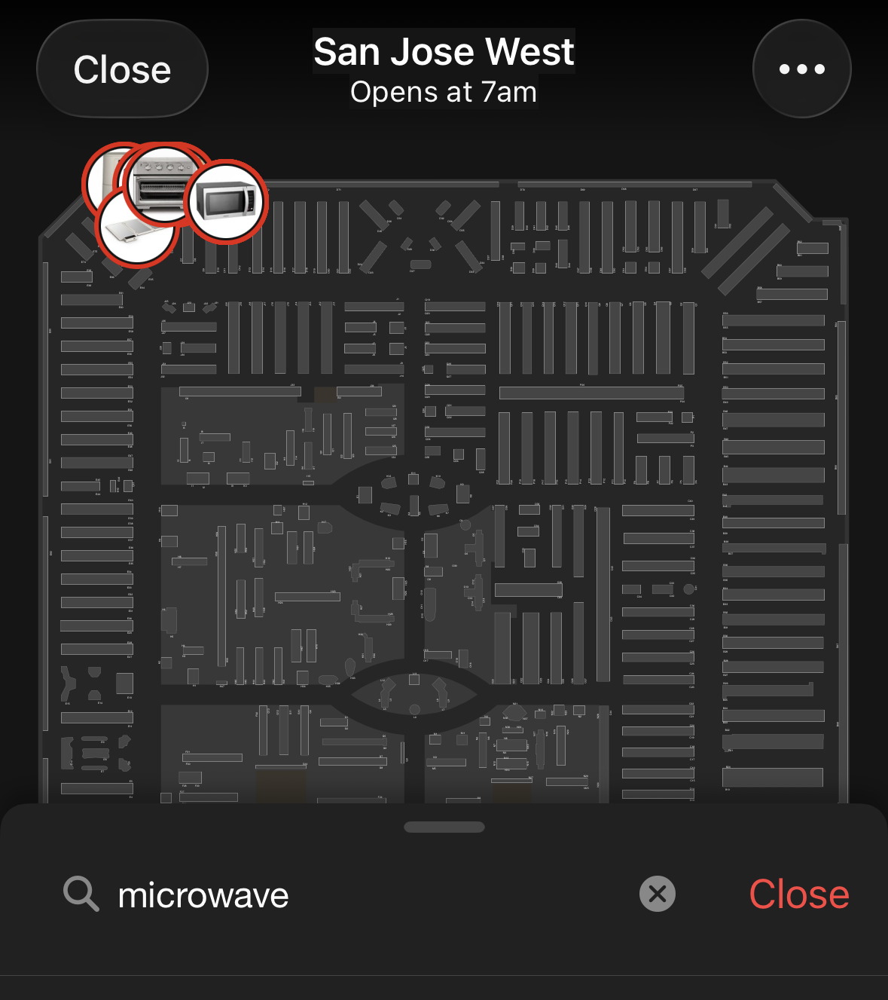
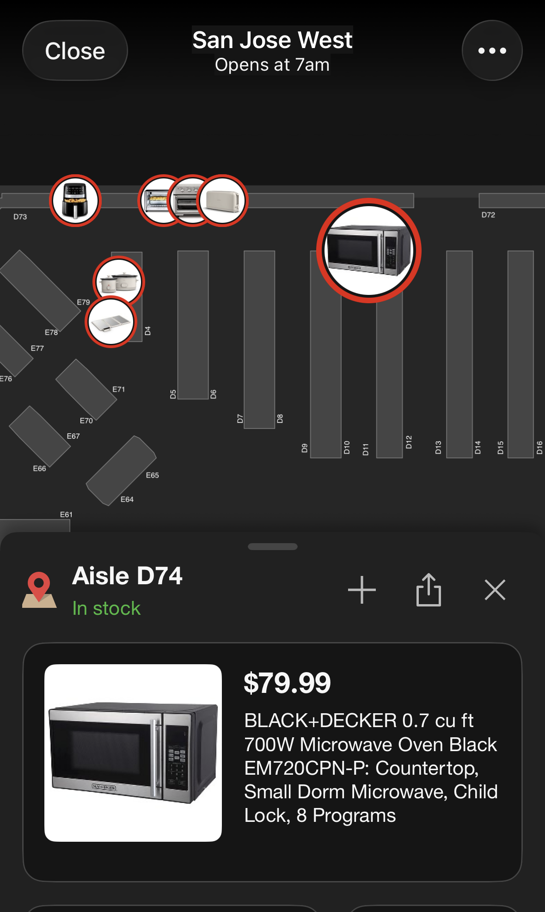
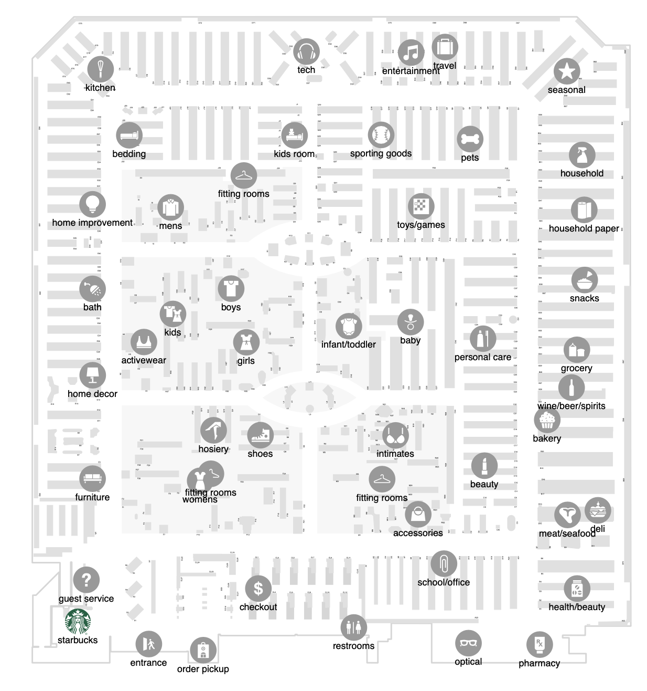
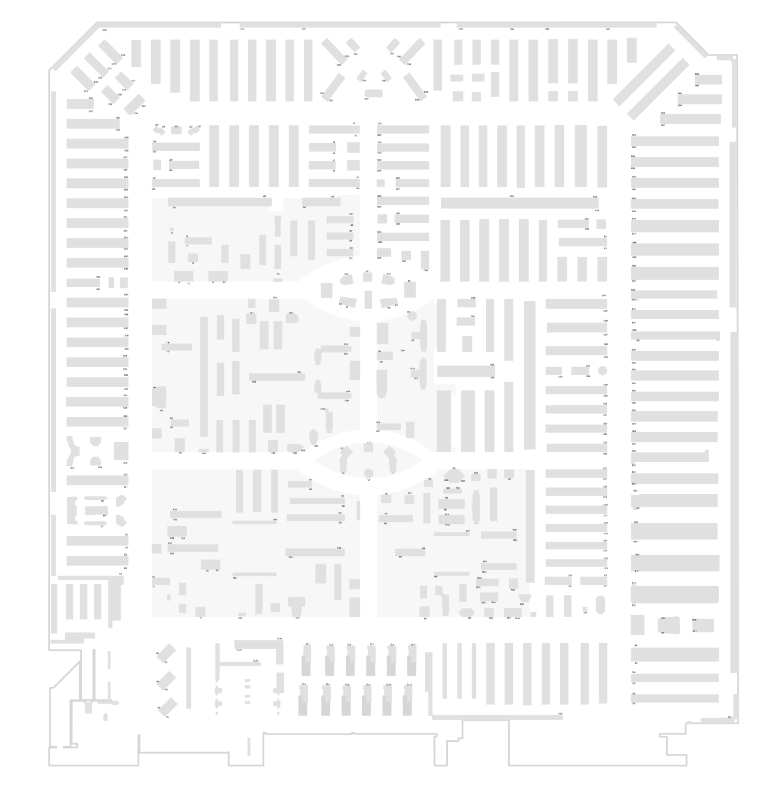
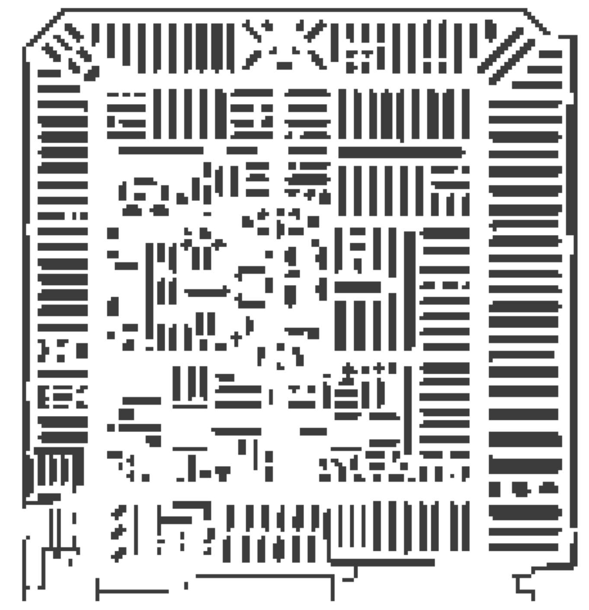
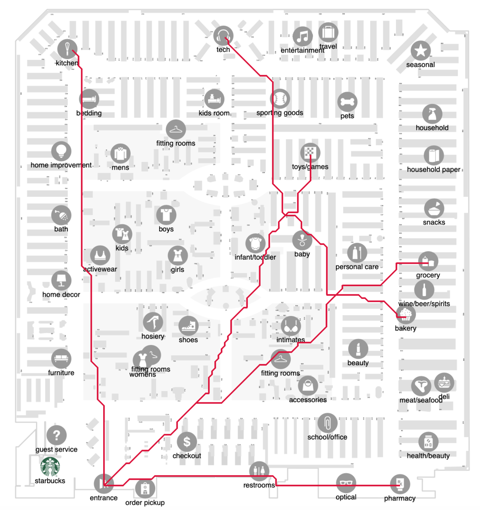
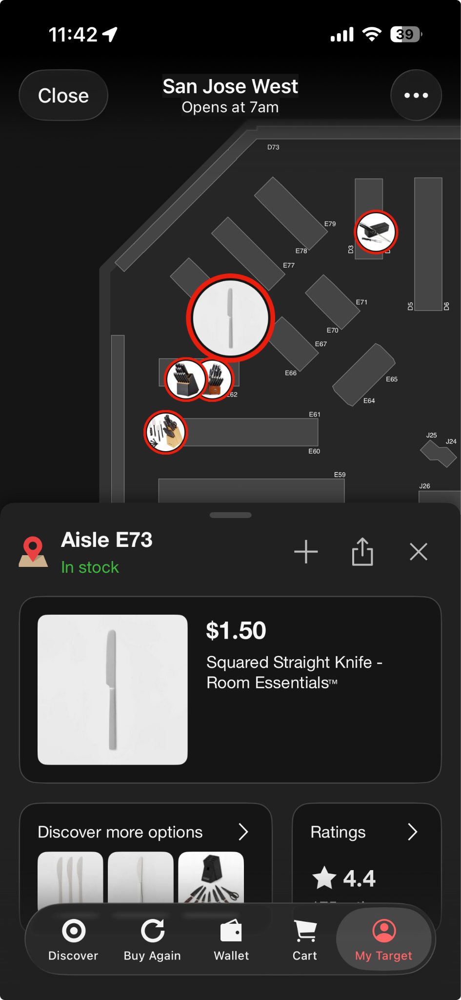
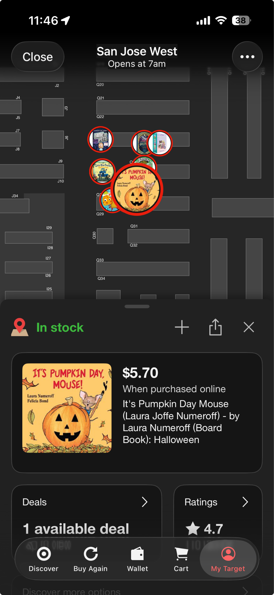
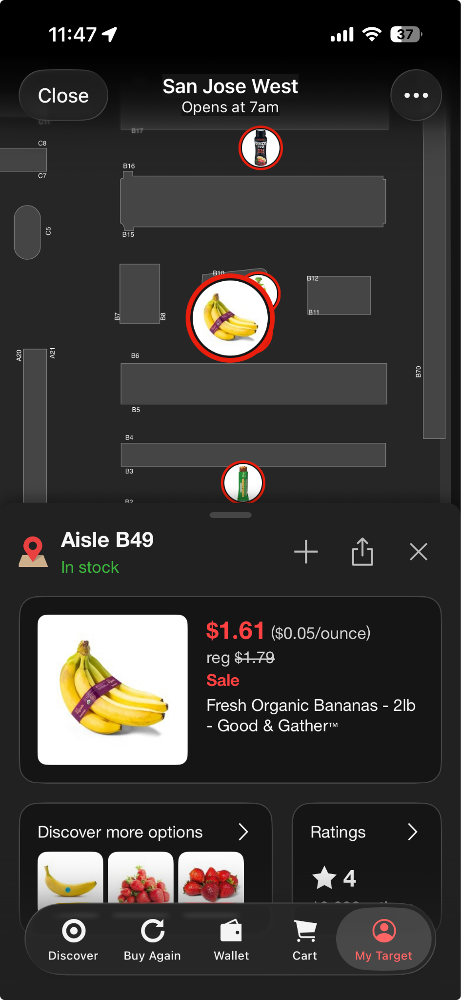

## 2D Path Planning

Route a shopper through the items on their checklist, from the store entrance to each item's aisle and (optionally) to checkout, using a 2D grid map of the store.

- **Store**: Target San Jose West
- **Scope**: a section of the store, the aisles in the upper-right corner (per Josh)
- **Code**: [`feature/2d-path-planning`](https://github.com/SJSU-CMPE-195/group-project-team-ar/tree/feature/2d-path-planning/server/src/pathfinding) (not merged into `main` yet)

### 1. Data Collection

#### Aisle lookup with Target "Store Mode"
The Target mobile app's Store Mode searches a product and shows its exact location on the store map, including the aisle number. This data can be collected without going into the store.

 

#### Store map
Departments and aisle labels from the Store Mode map:

 

#### Walkable grid
The map is turned into a grid where **white = walkable path** and **dark = blocked** (shelves, walls).



#### Example paths
Sketch of routes from the entrance to different departments:



### 2. Test Checklist
Each item is a COCO class the object detection model (YOLOv7, COCO dataset) can recognize, so the same checklist can be used for navigation and detection.

| COCO label | Product | Aisle |
|---|---|---|
| `knife` | [Squared Straight Knife - Room Essentials™](https://www.target.com/p/squared-straight-knife-room-essentials-8482/-/A-85189945) | E73 |
| `microwave` | [BLACK+DECKER 0.7 cu ft 700W Microwave Oven EM720CPN-P](https://www.target.com/p/black-decker-0-7-cu-ft-700w-microwave-oven-black-em720cpn-p/-/A-50568401) | D74 |
| `book` | [It's Pumpkin Day, Mouse! - Laura Numeroff (Board Book)](https://www.target.com/p/it-39-s-pumpkin-day-mouse-laura-joffe-numeroff-by-laura-numeroff-board-book/-/A-48327869) | TBD (app shows no aisle; near Q28–Q29) |
| `banana` | [Fresh Organic Bananas - 2lb - Good & Gather™](https://www.target.com/p/organic-bananas-2lb-good-38-gather-8482/-/A-85759852) | B49 |

Store map references (the microwave is shown in the D74 screenshot above):

  

### 3. Map Data Format
Store maps are JSON files in `server/data/`. The current map is [`demo_store_map.json`](https://github.com/SJSU-CMPE-195/group-project-team-ar/blob/feature/2d-path-planning/server/data/demo_store_map.json), a **9×7 placeholder grid, not the real Target layout**:

```json
{
  "name": "DEMO ONLY - not the real Target store",
  "grid": [
    [0,0,0,0,0,0,0,0,0],
    [0,1,1,0,1,1,1,1,0],
    [0,1,1,0,1,1,1,1,0],
    [0,0,0,0,0,0,0,0,0],
    [0,1,1,0,1,1,1,1,0],
    [0,1,1,0,1,1,1,1,0],
    [0,0,0,0,0,0,0,0,0]
  ],
  "entrance": [0,6],
  "checkout": [1,6],
  "aisles": {
    "E73": [3,0],
    "D74": [8,0],
    "B49": [8,6]
  }
}
```

| Field | Meaning |
|---|---|
| `grid[y][x]` | `y` is the row, `x` is the column (note the order). `0` = walkable, `1` = blocked. All rows must be the same length. |
| `entrance`, `checkout` | `[x, y]` cells |
| `aisles` | Aisle ID → `[x, y]` goal cell. IDs are case-insensitive (`e73` → `E73`). |

`loadStoreMap()` rejects a map if the grid isn't rectangular 0/1, or if the entrance, checkout, or any aisle cell is not walkable.

### 4. Implementation
All code is in `server/src/pathfinding/` on the `feature/2d-path-planning` branch.

| File | What it does |
|---|---|
| [`astar.ts`](https://github.com/SJSU-CMPE-195/group-project-team-ar/blob/feature/2d-path-planning/server/src/pathfinding/astar.ts) | `findPath(grid, start, goal)`: A* shortest path. 4-direction moves (no diagonals), each step costs 1, Manhattan distance heuristic. Returns the list of `[x, y]` cells, or `null` if there's no route or start/goal is blocked. |
| [`routePlanner.ts`](https://github.com/SJSU-CMPE-195/group-project-team-ar/blob/feature/2d-path-planning/server/src/pathfinding/routePlanner.ts) | `planRoute(map, aisleIds, start?, finishAtCheckout?)`: picks the visiting order with the fewest total steps by trying every order (pruning orders already longer than the best). Max 8 aisles. Duplicate aisles are removed; unknown aisles throw. |
| [`storeMap.ts`](https://github.com/SJSU-CMPE-195/group-project-team-ar/blob/feature/2d-path-planning/server/src/pathfinding/storeMap.ts) | `loadStoreMap(filename = 'demo_store_map.json')`: reads and validates a map from `server/data/`. |
| [`testPathfinding.ts`](https://github.com/SJSU-CMPE-195/group-project-team-ar/blob/feature/2d-path-planning/server/src/pathfinding/testPathfinding.ts) | Tests: route to E73, never crosses obstacles, unreachable goal, start = goal, blocked start, multi-item route. |

#### API: `POST /api/navigation/route`
Defined in [`server/src/index.ts`](https://github.com/SJSU-CMPE-195/group-project-team-ar/blob/feature/2d-path-planning/server/src/index.ts).

Request:
```json
{
  "aisles": ["E73", "D74", "B49"],
  "start": [0, 6],
  "checkout": true
}
```
- `aisles` (required): up to 8 aisle IDs
- `start` (optional): `[x, y]` integers, defaults to the map's `entrance`
- `checkout` (optional): `true` to end the route at checkout, defaults to `false`

Response (on the demo map):
```json
{
  "visitOrder": ["E73", "D74", "B49"],
  "path": [[0,6], ..., [1,6]],
  "totalSteps": 27
}
```

Errors: `400` for invalid input or an unknown aisle, `404` if no walkable route exists.

#### Run the tests
```bash
git checkout feature/2d-path-planning
cd server
npm install
npx tsx src/pathfinding/testPathfinding.ts
```

### 5. Next Steps
- [ ] Replace the demo grid with the real grid for the upper-right store section, in the same format
- [ ] Map aisle IDs (E73, D74, B49, …) to their real grid cells
- [ ] Find the book's aisle number
- [ ] Check performance on the real grid: the A* open list is a linear scan and the planner tries up to 8! = 40,320 orders, which is fine on a 9×7 grid but may be slow on a large one
- [ ] Lens Studio integration: import the map JSON as a text asset (or inline it in a script) and call the route API
- [ ] Locate the shopper on the map (indoor localization, or use detected objects as landmarks)
- [ ] Guidance UI: start with voice navigation, then arrows (fewer distractions)
- [ ] Walk the route in Target and time it
